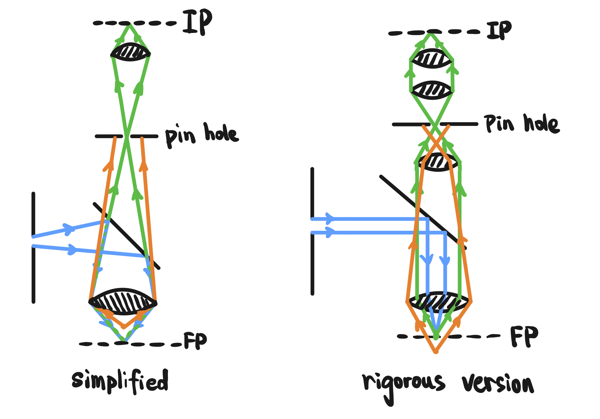
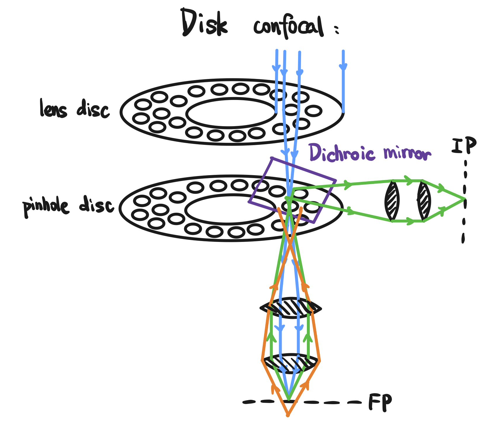

Confocal microscope has two important properties. The first one is there is a pinhole (or pinholes) in the optic relay path, to restrict the emissions from planes other than focal plane. The second property is that the confocal microscope performs point-to-point imaging, which makes its imaging a bit slow.

The following figure is the optic path of regular confocal microscope. The blue light illustrates the excitation beam, while the green light illustrates the emitted beam from the focal plane. The orange light represents the off-plane emission light blocked by the pinhole. Textbooks usually use the simplified form, which is not quite correct in terms of physics (say, the focal plane light source should generate parallel beam after crossing the objective). The form on the right is more accurate.

The two forms above have drawbacks: the point-wise imaging makes the scanning process quite slow, and one can't look into the eye lens to see what's going on. The disc form confocal microscope solves this problem.

From the optic pathway, it's still point-wise, but hundreds of points at the same time. The disc spins very fast and the point-wise scanning covers the entire field of view. Due to the persistence of vision, people can look into the eye lens and have the illusion of "I'm looking at a very consistant and simultaneous imaging result".