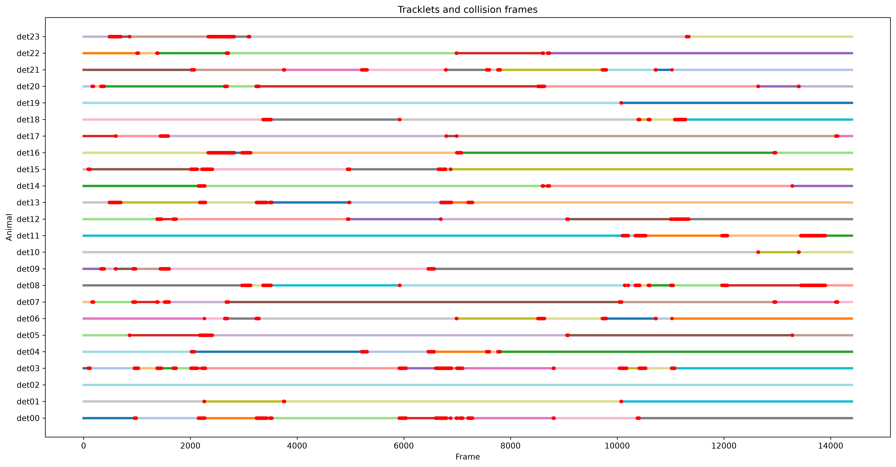
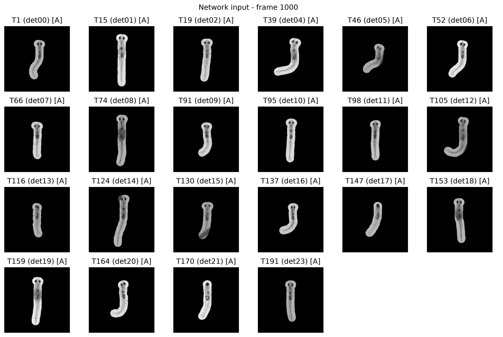
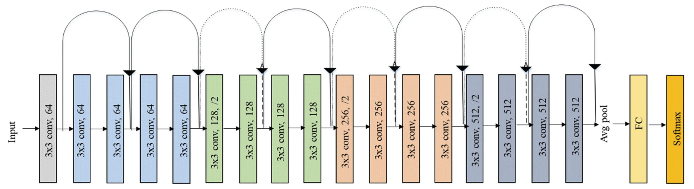

## Usage
The code is modified from idtracker.ai(https://idtracker.ai/latest/), it uses almost the same network structure (i.e. same contrast learning framework) as idtracker.ai, but simplified a little and adjusted the pre-processing step for transparent animals. The original pipeline (https://elifesciences.org/articles/107602) is using idtracker.ai to obtain IDs and cropped single-individual windows. By doing this, one can then feed the single individual data to DeepLabCut and identify their skeleton postures.

The modified code works in a different way. Since the idtracker's preprocessing step, the hard-coded threshold segmentation algorithm works badly in identifing transparent animals, we need to tell the model where the fishes are. This requires us to do skeleton estimation first, and use the contrastive learning framework as a posthoc proofread method.

To run the code, we need data: raw video `raw_video_record.mp4`, skeleton data `points2d.pq` and bounding box data `instances.pq` (optional, sanity check in `ipynb` file need this). You can first run the `visualization.ipynb` on your PC to do a quick check if your data structure fits, after that you can run `id_correction.py` either on PC or on server using command `python id_correction.py --video raw_video_record.mp4 --points points2d.pq --n_ids animal_number`. An actual case example is:

```bash
python id_correction.py --video rec_20260525-205714.mp4 --points points2d.pq --n_ids 24
```

 If we want to adjust params of the model, the full command is (we can also ajdust these params in `id_correction.py` directly):

```bash
python id_correction.py \
    --video raw_video_record.mp4 \
    --points points2d.pq \
    --n_ids 24 \
    --blob_radius 8 \
    --blob_visualize_frame 22 \
    --min_tracklet_length 10 \
    --epochs 50 \
    --steps_per_epoch 50 \
    --pairs_per_type 200 \
    --micro_batch_pairs 16 \
    --stride 12 \
    --max_frames 500 \
    --val_ratio 0.2 \
    --canvas_size 192 \
    --silhouette_images_number 3000 \
    --hard_fraction 0.5 \
    --embedding_dim 8 \
    --lr 0.02 \
    --preprocessed_visualize_frame 1000 \
    --embedding_samples_per_tracklet 30 \
    --patience 8 \
    --seed 0
```

Where `--video` specifies the input video path; `--points` specifies the SLEAP skeleton data file; `--n_ids` sets the total number of animals; `--blob_radius` controls the pixel radius used for blob extraction; `--blob_visualize_frame` selects a frame for blob visualization; `--min_tracklet_length` sets the minimum tracklet length in frames; `--epochs` sets the maximum number of training epochs; `--steps_per_epoch` defines the number of training steps per epoch; `--pairs_per_type` specifies the number of positive and negative pairs sampled per step; `--micro_batch_pairs` sets the number of pairs processed per micro-batch; `--stride` controls the frame sampling interval; `--max_frames` limits the number of sampled frames; `--val_ratio` determines the proportion of frames used for validation; `--canvas_size` sets the dimensions of the preprocessed images; `--silhouette_images_number` limits the number of images used for silhouette evaluation; `--hard_fraction` controls the weighting of hard-example sampling; `--embedding_dim` sets the dimensionality of the learned embeddings; `--lr` specifies the learning rate; `--preprocessed_visualize_frame` selects a frame for visualizing preprocessed images; `--embedding_samples_per_tracklet` sets the number of sampled images per tracklet for embedding extraction; `--patience` controls early stopping after consecutive epochs without improvement; and `--seed` sets the random seed for reproducibility.

The output files will include: preprocessed fish masks `blob.pkl`, blob mask visualization `blobs_rendered.png`, tracklets visualization `tracklets.png`, trained model parameter `reid_model.pt`, global ID labeled skeleton file `points2d_reid.pq` and the rendered re-identified video `reid_video.mp4`.


## Data Pre-processing
### split tracklets
The most natural way to construct the positive and negative pairs for contrast learning is using the continuous tracking sessions (this is also the method used by idtracker.ai). If an individual is continuously tracked by the system and doesn't collide with other fishes, its identity has to remain unswitched. Thereby, a single, uncollided session (here we all it a 'tracklet') could use its own frames to form positive pairs. Meanwhile, the uncollided sessions occur at the same time (tracking different fish individuals) can be used to form negative pairs.

The function `split_tracklets()` in `utils.py` do the tracklet split for us. It will return `tracklets` and `collisions` dictionary. `tracklets[tid]["frames"]` will give the image information (blob pixels of one fish) of a certain frame. `collisions[aid]` will give all the frames that is engaged in the collision. `tid` is tracklet number, `aid` is animal number. (Look into the code for more information)

The figure below shows the distribution of individual tracklets, red markers represent the fish is colliding with other fishes, and the colorful segments represent single, uncollided sessions.


### make blobs and re-align fishes' direction
We want the figures feed into the convolution network contains only the morphological features of the fish individuals, not the environment nor the heading direction of the fishes. Therefore, it's better to extract the fishes from the background and re-align them (rotate their body axis to match the vertical axis). This extraction and re-alignment process is completed by class `BlobCache`.


## Contrastive Learning Framework
### Architecture
The neural network is adapted from ResNet18 (depth=$18$), which has the architecture:


In order to fit with fish data, the following modifications were made:

```python
self.net.conv1 = nn.Conv2d(1, 64, 7, 2, 3, bias=False) # single channel data, we did a RGB to gray to simplify the model
self.net.fc = nn.Linear(512, embedding_dim, bias=False) # embedding_dim=8 as default
```


### Sampling Logic
Positive pairs are sampled from the same tracklet, while the negative pairs are sampled from overlapping tractlet pairs (which must represent different fishes). Equal number of positive pairs and negative pairs are sampled during training. There is a "hardness" vector specifies the training hardness of tracklets(+ samples) and tracklet pairs(- samples), using the information from training loss. The hardness vector will change the sample weight of the tracklets and tracklet pairs, enabling the "dynamic sampling strategy", give harder samples more chances.

### Loss Function
The loss function is defined as:
```python
@staticmethod
    def loss_fn(z1, z2, y, pos_margin=1.0, neg_margin=10.0):
        d = F.pairwise_distance(z1, z2)
        loss = y * F.relu(d - pos_margin).pow(2) + (1 - y) * F.relu(neg_margin - d).pow(2)
        return loss.mean(), d
```

Which can be written in math:
$$
\mathcal{L}=\frac{1}{N}\sum_{i=1}^{N}\left[y_i\max(0,d_i-m_+)^2+(1-y_i)\max(0,m_--d_i)^2\right]
$$

where $d_i$ is the Euclidean distance of two embedded vectors, $y_i=1$ for positive pairs and $y_i=0$ for negative pairs. The default margins are $m_+=1$ and $m_-=10$. The loss encourages embeddings of the same fish to be close while separating different fish. Note that this is a very intuitive and the simplist loss function in contrast learning, we can also try other fancier loss functions if the training result is disappointing in the future.

### Re-ID logic
The logic is written in function `assign_ids` in class `ReIDMethod`. 

First, embeddings from sampled frames are averaged to obtain one representative embedding per tracklet. If there is $100$ tracklets and the `n_ids` is $24$, then $76$ tracklets connections are required to be made. The algorithm choose connections vaildly (which means it can't concatenate two overlapped connections and each tracklet can have at most 1 predecessor tracklet and 1 sucessor tracklet) and with the least cost (minimize the summation of distances between connected tracklets). After doing this we obtain the global IDs(ranges from $0$ to $23$) of each tracklets.

Then, we need to screen through the collided frames and use the trained model to predict the colliding fishes' embedding position. After that we can calculate which global ID it belongs to (the nearest embedding distance) and finish the re-ID.

## Awareness
This algorithm highly relies on the correctness of the preceding skeleton identification algorithm. We need a clear and stable skeleton file, otherwise the blob crop process will go wild, and all the downstream process will have severe problems.
